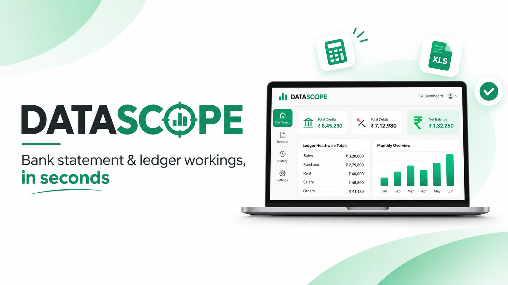

<p align="center">
  
</p>

<p align="center">
  
</p>

<h1 align="center">DATASCOPE</h1>

<p align="center">
  <b>Bank statement and ledger workings for accountants and CAs in India.</b><br>
  Import a client's data, get head-wise totals, GST workings and audit flags, then export to Excel.
</p>

<p align="center">
  
  
  
  
</p>

---

## Why DATASCOPE

Most accountants start every engagement the same way: open a bank statement, clean it up, group entries into heads, and look for anything odd. DATASCOPE does that first pass in seconds, and the file never leaves your computer.

## Features

**Import**
- Upload **CSV, XLSX, XLS or JSON** files, or drag and drop them.
- Reads Tally, Busy and Zoho exports and bank statements.
- Skips the address and summary lines at the top of bank statements to find the real header row.
- Auto-detects Date, Amount, Debit, Credit, Type, Narration and Running Balance columns. You can correct any of them.
- Understands `dd/mm/yyyy` dates, Excel dates, `₹1,25,000` style amounts, and Dr/Cr columns.

**Workings**
- **Head-wise totals:** debit and credit by ledger head, with a total row.
- **Ledger rules:** write your own mappings, one per line (for example `swiggy = Staff welfare`). They apply before the built-in rules.
- **Financial year filter:** April to March periods (FY 2026-27 and so on).
- **Month-by-month chart** of credits and debits.
- **Indian number format:** lakh and crore grouping, with short forms like ₹4.25 L and ₹1.20 Cr.

**GST estimate**
- Choose 0, 5, 12, 18 or 28%, with amounts either including or excluding GST.
- Splits into CGST and SGST for same-state, or IGST for other-state.
- Shows GST collected, GST paid and the estimated net payable.
- Can skip salaries, taxes, loans and interest when working out claimable GST.
- Includes a GSTIN format checker.

**Audit checks** (prompts for review, not conclusions)
- Cash payments above ₹10,000 (review s.40A(3)) and cash receipts of ₹2 lakh or more (review s.269ST).
- Running balance that does not tally with the previous balance plus credits minus debits.
- Possible duplicates (same date, amount and narration).
- Round amounts, Sunday-dated entries and unusually large entries.
- Missing cells, exact duplicate rows and rows without a clear amount or Dr/Cr, with one-click duplicate removal.

**Export**

| Format | Extension | Contents |
|---|---|---|
| Excel workbook | `.xlsx` | Transactions, Head-wise totals and Audit flags sheets |
| Clean data | `.csv` | The cleaned records, safe to open in Excel |
| PDF | `.pdf` | Use **Print / Save as PDF** from the Summary tab |

**Design**
- Clean white and green interface.
- Works on desktop and mobile.
- Follows the device's light or dark mode.

## Built with

- HTML5, CSS3 and plain JavaScript (a single file, no build step)
- [SheetJS](https://sheetjs.com/) for reading and writing Excel files

## Getting started

1. Download or clone this repository.
2. Open `index.html` in a modern browser.
3. Choose a file, or click **Try sample data** to explore.

```bash
git clone https://github.com/YOUR-USERNAME/datascope-analytics.git
```

No installation or server is needed. Excel support loads the SheetJS library from a CDN, so it needs an internet connection the first time. CSV and JSON files work without one, apart from Excel export.

## Project structure

```
DATASCOPE/
├── index.html
├── README.md
└── assets/
    ├── logo.png
    └── banner.png
```

`logo.png` and `banner.png` are used by this README.

## Privacy

Files are read and processed in your browser. Nothing is uploaded to a server.

## Important notice

DATASCOPE is a workings and review aid. It is not a substitute for professional judgment, audit procedures, tax advice or official GST filing software.

- GST figures are estimates that use a single rate for all rows. Actual GST depends on each invoice's rate, place of supply and exemptions.
- Audit flags only point to entries worth a closer look. Provisions such as s.40A(3) and s.269ST depend on the party, mode of payment and thresholds, so confirm each case.
- Always verify figures against the original records and the applicable rules before relying on them.

---

<p align="center"><b>DATASCOPE — Understand your data.</b></p>
